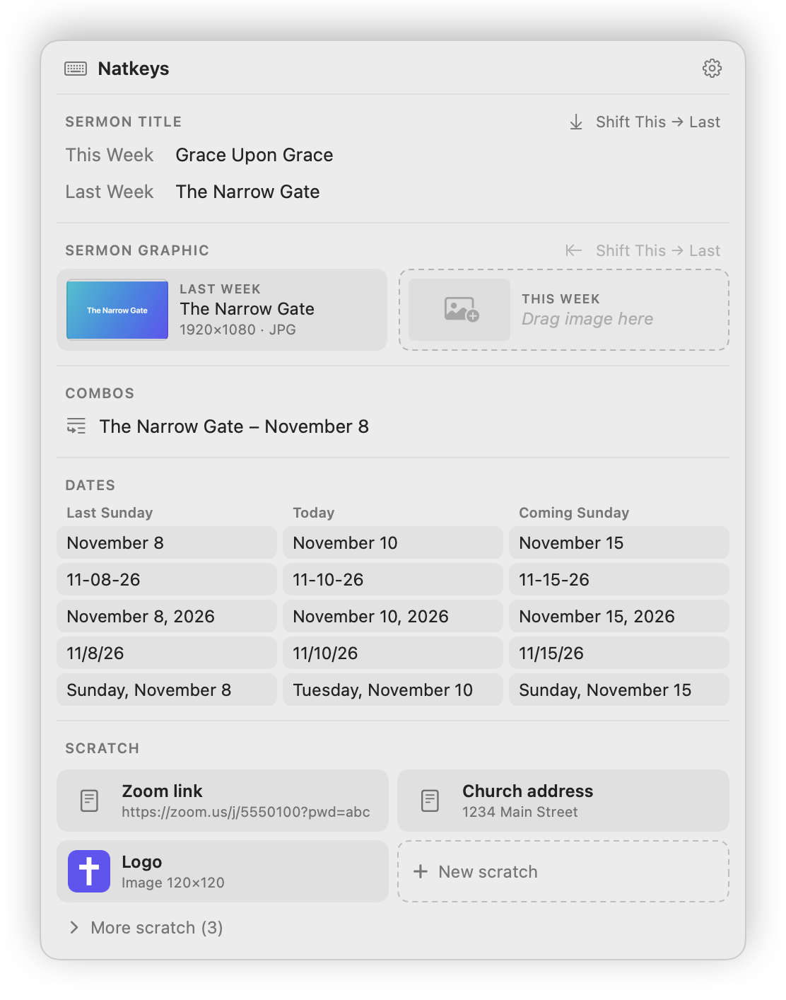

# Natkeys

A macOS menu bar app for church media: press **Option+Space** to paste sermon titles, Sunday
dates, and graphics in one click.

Natkeys opens a small panel at your mouse. Click once to paste this week's or last week's sermon
title, a Sunday date in the format you need, a combo of the two, or one of your scratch
clipboards into the app you're typing in. Drag a sermon graphic straight into a website's upload
box. It's built for weekly church media work, and it's just as handy for anything else you paste
again and again.

<p align="center">
  <picture>
    <source media="(prefers-color-scheme: dark)" srcset="docs/images/readme-panel-dark.png">
    
  </picture>
</p>

## Download and install

1. Download **Natkeys-x.y.z.dmg** from the [latest release](https://github.com/allegedlynatalie/natkeys/releases/latest).
2. Open it and drag **Natkeys** into **Applications**.
3. Open Natkeys from Applications. The first time, macOS says it can't check Natkeys for
   malware, because the app isn't notarized by Apple. Click **Done**, then go to
   **System Settings → Privacy & Security**, scroll down to the message about Natkeys, click
   **Open Anyway**, and confirm. You only do this once.
4. When asked, turn on Natkeys under **Accessibility** (see [Permissions](#permissions)).
5. Press **Option+Space** in any app. Natkeys lives in the menu bar (⌨︎) and starts at login.

Requires macOS 14 Sonoma or later, on Apple silicon or Intel.

**Updating:** quit Natkeys (menu bar icon → Quit Natkeys), download the new version, and drag it
into Applications, replacing the old one. Your groups, scratch clipboards, and the Accessibility
permission carry over.

**Uninstalling:** quit Natkeys and move it from Applications to the Trash. Your data is in
`~/Library/Application Support/Natkeys` if you want to delete that too. You can also remove
Natkeys from System Settings → Privacy & Security → Accessibility and from General → Login Items.

## Using it

**Paste something:** click into a text box, press **Option+Space**, and click what you want.
Natkeys pastes it, then puts your own clipboard back.

**Save selected text:** select text in any app (for example, this week's sermon title), press
**Option+Space**, and click **Save** next to the slot it belongs in. The panel also shows your
current clipboard as a chip. Click that chip to save the clipboard instead, which is handy for
images you copied with "Copy Image".

**Panel sections**

| Section | What it does |
| --- | --- |
| **Sermon Title** (and any other weekly groups) | This Week / Last Week. **Shift This → Last** moves This Week down. This also happens automatically **every Sunday at 2:00 PM**, and catches up if the Mac was off. |
| **Image groups** (such as Sermon Graphic) | Two thumbnails side by side: Last Week on the left, This Week on the right. Drop an image onto a slot to save it (or click an empty slot to choose a file). **Drag a thumbnail straight into a website's upload box**, or click it to paste. The original file is kept, so a JPG stays a small JPG and uploads under its own name. |
| **Combos** | One-click templates such as `The Narrow Gate – November 1`. |
| **Dates** | Every format × Last Sunday / Today / Coming Sunday. On Sundays the dates flip at 2:00 PM, matching the sermon shift. |
| **Scratch** | Text or image clipboards. Pinned ones always show; the rest are under **More**. Click to paste, drag an image straight into a website's upload box, or drop text or images onto a tile to save them. |

Right-click anything in the panel for more options: Copy, Edit…, Pin/Unpin, Replace with
Clipboard, Clear, and Delete. Press **Esc** or click elsewhere to close the panel.

**From any app's right-click menu:** Natkeys adds two macOS Services.
- **Open Natkeys** appears when you right-click in a text box, and works the same as Option+Space.
- **Save to Natkeys** appears when you right-click selected text, including on web pages. It
  opens the panel with that text ready to save.

macOS decides where they go. With text selected they're usually listed near the bottom of the
menu; otherwise look under **Services ▸**. You can turn either one off, or give it its own
shortcut, in System Settings → Keyboard → Keyboard Shortcuts… → Services → Text.

**Settings** (gear icon in the panel, or the ⌨︎ menu bar icon → Settings…) has these tabs:
- **General:** Sunday flip time, clipboard restore, launch at login, Export/Import backup.
- **Weekly Groups:** rename groups, add new ones (Scripture, Preacher…), edit values, and turn auto-shift on or off per group. **Holds: Text / Image** sets what a group stores. Switching a group to Image picks up a slot that holds the path of an image file (for example, from dropping a file into the text box), and its text is kept in case you switch back.
- **Combos:** edit templates. **Insert Field** adds `{Sermon Title: Last Week}`, `{Last Sunday: MMMM d}`, and similar fields.
- **Date Formats:** add, remove, and reorder rows of the date grid.
- **Scratch:** name, pin, reorder, and edit scratch clipboards.

## Permissions

Natkeys needs **Accessibility** access (System Settings → Privacy & Security → Accessibility)
to read selected text and press ⌘C/⌘V for you. Without it the panel still opens, but clicking an
item only copies it, so you'd press ⌘V yourself. Once you switch it on, a bubble says
"Natkeys can paste for you now".

**Switched on, but Natkeys still says it isn't allowed?** macOS saves the permission for the
exact build you allowed. If Natkeys was later signed differently (for example, before and after
you made the certificate below), that saved permission never matches again, and switching it off
and on doesn't update it. Click **Reset Permission** in Settings → General (or click *Allow
auto-paste…* in the panel a second time). Natkeys removes itself from the list and asks again;
switch it on when it reappears. You can also do this in Terminal:

```bash
tccutil reset Accessibility io.github.allegedlynatalie.natkeys
```

If Option+Space doesn't open the panel, another app may own it. Launchers and AI apps often use
it (Claude's Quick Entry does by default). Change that app's shortcut, then use the menu bar
icon → *Try Again*.

## Privacy

Everything Natkeys stores stays on your Mac, in `~/Library/Application Support/Natkeys`. There
are no accounts, analytics, or update checks. Natkeys reads the selected text only when you open
its panel, and presses ⌘C and ⌘V only to copy that selection and to paste what you click. The
only time it goes online is when you drag a picture from a web page that hands over just the
picture's web address; then it downloads that one picture.

## Building from source

Needs only the Xcode Command Line Tools (Swift 6), not the full Xcode.

```bash
./scripts/install.sh        # build, copy to /Applications, launch
./scripts/build-app.sh      # just build build/Natkeys.app
swift test                  # date math, weekly shift, combo template tests
./scripts/release.sh 1.0.0  # the downloadable build/release/Natkeys-1.0.0.dmg
```

`release.sh` builds one app for Apple silicon and Intel, packages it as a disk image, and writes
its checksum and draft release notes. With an Apple **Developer ID Application** certificate in
your keychain it signs for notarization, and with `NOTARY_PROFILE` set to a saved
`xcrun notarytool store-credentials` profile it notarizes and staples the disk image, so it opens
with no warning.

> Without a Developer ID, builds are signed with a self-signed **Natkeys Local** certificate if
> one is in your keychain (Keychain Access → Certificate Assistant → Create a Certificate… → Code
> Signing). Keychain Access will say it's "not trusted"; that's fine. Because every build carries
> the same identity, the Accessibility permission survives rebuilds and updates. Without any
> certificate each build is signed ad hoc, and you'd need **Reset Permission** after every
> reinstall.

`Natkeys --snapshot <folder>` renders the panel and Settings tabs to PNGs using sample data,
without touching your real data. It's useful for checking layout changes, and it makes the
pictures in this README (`readme-panel-light.png` and `readme-panel-dark.png`).

## Layout

```
Sources/NatkeysCore/   pure logic: data model, Sunday math, auto-shift, combo templates (tested)
Sources/Natkeys/
  AppDelegate.swift    menu bar icon, hotkey, timers, Settings window
  Store.swift          load/save ~/Library/Application Support/Natkeys (data.json + Images/)
  Panel/               the floating panel (AppKit window + SwiftUI views, drag & drop tiles)
  System/              hotkey, clipboard, selection grab, paste, HUD, login item
  Windows/             Settings and editor windows
Tests/NatkeysCoreTests/
docs/DESIGN.md         the decisions behind how it works
docs/images/           README pictures (from --snapshot)
scripts/               build, install, and release scripts
```

## License

MIT. See [LICENSE](LICENSE).
